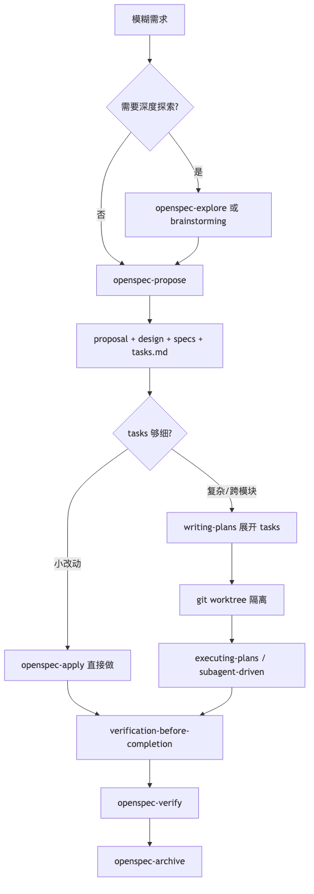
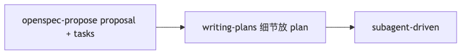
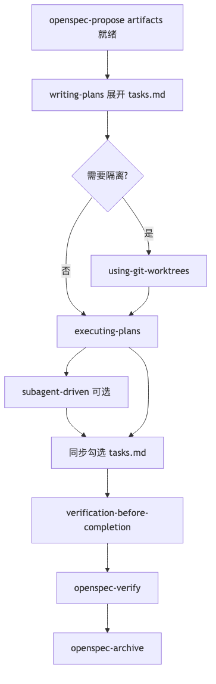
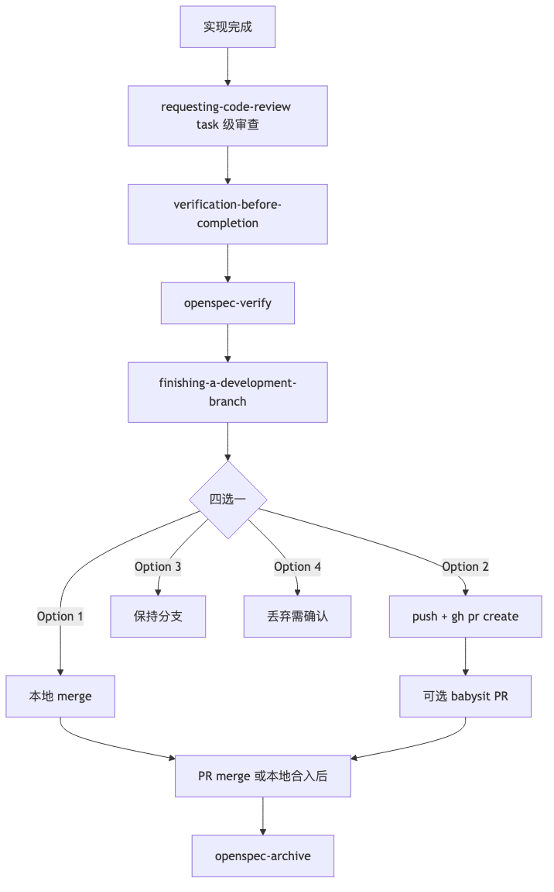

# OpenSpec × Superpowers 混合工作流 — 会话纪要

> 整理日期：2026-05-22  
> 适用项目：SidusDMX（Acrux iPad）  
> 相关文档：`OpenSpec-Superpowers-混合工作流心得.md`（SOP 主文档）

---

## 目录

1. [会话概览](#1-会话概览)
2. [混合工作流怎么搭配](#2-混合工作流怎么搭配)
3. [OpenSpec artifact 是什么](#3-openspec-artifact-是什么)
4. [propose 之后如何用 Superpowers 执行](#4-propose-之后如何用-superpowers-执行)
5. [Superpowers 与 PR 的实现](#5-superpowers-与-pr-的实现)
6. [Markdown 文档如何插入图片](#6-markdown-文档如何插入图片)
7. [流程图导出与 SOP 更新记录](#7-流程图导出与-sop-更新记录)
8. [附录：完整 SOP 文档结构](#8-附录完整-sop-文档结构)
9. [附录：常用 Prompt 模板](#9-附录常用-prompt-模板)

---

## 1. 会话概览

本次会话围绕 **OpenSpec 与 Superpowers 如何混用** 展开，依次讨论了：

| 序号 | 主题 | 结论要点 |
|------|------|----------|
| 1 | 混合工作流搭配 | OpenSpec 管变更档案，Superpowers 管执行纪律 |
| 2 | artifact 含义 | 变更生命周期中的标准化工件（proposal/design/specs/tasks） |
| 3 | propose 后的 Superpowers 执行 | writing-plans → executing-plans，与 openspec-apply 二选一 |
| 4 | Superpowers PR 流程 | finishing-a-development-branch Option 2，非自动建 PR |
| 5 | SOP 加流程图 | Mermaid + PNG 双轨，相对路径引用 |
| 6 | MD 能否加图片 | 可以，`` |
| 7 | 导出 PNG 并更新 SOP | 已生成 6 张 PNG + 更新主 SOP 文档 |

---

## 2. 混合工作流怎么搭配

### 2.1 一句话总结

**OpenSpec 管「变更生命周期 + 规格归档」，Superpowers 管「设计门禁 + 细粒度执行纪律」。**

OpenSpec 是变更的**单一事实来源**；Superpowers 是**安全落地**的执行层。两者分层互补，不是二选一。

### 2.2 核心分工

| 阶段 | 主导工具 | 产出位置 |
|------|----------|----------|
| 探索 / 澄清 | OpenSpec explore 或 Superpowers brainstorming | 对话 → 回填 OpenSpec artifact |
| 变更定义 | OpenSpec new / continue / propose | `openspec/changes/<name>/` |
| 需求 & 设计 | proposal + design + delta specs | 同上 |
| 粗粒度任务 | tasks.md | 同上 |
| 细粒度执行计划 | Superpowers writing-plans | `superpowersDocs/plans/YYYY-MM-DD-<name>.md` |
| 写代码 | executing-plans / subagent-driven | 代码 + 勾选 task |
| 验收 | verification-before-completion + OpenSpec verify | 验证报告 |
| 收尾 | OpenSpec archive + finishing-a-development-branch | `openspec/specs/` 合并 |

### 2.3 推荐主流程



```
模糊需求
  ↓
[可选] explore / brainstorming（探索，不写代码）
  ↓
openspec-propose（或 new + continue）
  → proposal.md + design.md + specs/ + tasks.md
  ↓
tasks 够细？
  ├─ 小改动 → openspec-apply 直接做
  └─ 复杂/跨模块 → writing-plans → git worktree → executing-plans
  ↓
verification-before-completion
  ↓
openspec-verify
  ↓
openspec-archive
```

### 2.4 三种搭配模式

**模式 A：OpenSpec 为主（推荐默认）**


```
explore → propose → [writing-plans 可选] → apply/executing → verify → archive
```

适合：常规功能开发，需要 spec 归档、团队可追溯。

**模式 B：Superpowers 探索 + OpenSpec 立项**


```
brainstorming（用户批准）→ openspec-propose → writing-plans → 执行
```

适合：UI/交互复杂、边界条件多、方案需先对齐再立项。

**模式 C：OpenSpec 轻量 + Superpowers 重执行**



```
openspec-propose（proposal + tasks）→ writing-plans → subagent-driven
```

适合：域内熟悉、tasks 已够清楚，但需要 TDD / 细步执行纪律。

### 2.5 探索期：二选一，不要双写

| 工具 | 特点 | 何时用 |
|------|------|--------|
| **openspec-explore** | 结对思考，可写 artifact，不写代码 | 已有变更上下文、中途卡住、方案对比 |
| **brainstorming** | 设计门禁，必须用户批准后才进实现 | 全新功能、需求模糊 |

**原则**：探索结论回填 OpenSpec artifact，不要另起 `superpowersDocs/specs/` 重复写 design（除非纯调研、尚未立项）。

### 2.6 任务粒度分层

| 层级 | 位置 | 粒度示例 |
|------|------|----------|
| 粗粒度 | OpenSpec `tasks.md` | 「实现 syncFromDevice」「真机验证充电状态」 |
| 细粒度 | Superpowers plan | 写 failing test → 跑失败 → 实现 → 跑过 → commit |

OpenSpec tasks 是里程碑；Superpowers plan 是可执行步。只在复杂 task 上展开 plan。

### 2.7 文档存放约定

| 内容 | 路径 |
|------|------|
| 变更 proposal / design / specs / tasks | `openspec/changes/<name>/` |
| Superpowers 执行计划 | `superpowersDocs/plans/YYYY-MM-DD-<name>.md` |
| Superpowers 独立设计（无 OpenSpec 时） | `superpowersDocs/specs/YYYY-MM-DD-<topic>-design.md` |
| 流程图 PNG | `SOP/images/` |
| 流程图 Mermaid 源码 | `SOP/mermaid-src/` |
| 归档后主 specs | `openspec/specs/` |

**语言**：OpenSpec artifact 与 Superpowers plan 用中文；代码与文件路径用英文。

### 2.8 避坑清单

1. **不要双轨维护 design** — 设计决策只写 `design.md`，执行细节写 plan
2. **brainstorming HARD-GATE** — artifacts 已齐时，先 `writing-plans` 再实现
3. **中途卡住** — 用 `openspec-explore <change>` 或 `systematic-debugging`，结论写回 artifact
4. **小改动可跳过 Superpowers** — 单文件 fix 直接 apply；大功能务必走 plan + 验证
5. **PR 不等于结束** — merge 后还需 `openspec-archive`

### 2.9 快速决策树

```
还没想清楚？        → explore / brainstorming
想清楚了要留档？    → openspec-propose
tasks 少且直观？    → openspec-apply
tasks 多/跨模块？   → writing-plans → executing-plans
做完了？            → verify（两层）→ archive
建 PR？             → finishing Option 2 → babysit（可选）
```

### 2.10 常用技能对照

| 意图 | OpenSpec | Superpowers |
|------|----------|-------------|
| 探索想法 | openspec-explore | brainstorming |
| 新建变更 | openspec-new-change / openspec-propose | — |
| 继续写 artifact | openspec-continue-change | — |
| 写执行计划 | — | writing-plans |
| 实现 | openspec-apply-change | executing-plans / subagent-driven |
| 代码审查 | — | requesting-code-review |
| 验收 | openspec-verify-change | verification-before-completion |
| 归档 | openspec-archive-change | finishing-a-development-branch |
| 隔离开发 | — | using-git-worktrees |
| PR 跟进 | — | babysit |

---

## 3. OpenSpec artifact 是什么

**Artifact** = 一次 change 在落地前，按 workflow 模板逐步写出的**结构化文档/规格文件**。

它是「变更的正式交付物」——不是代码，而是指导做什么、为什么、怎么做、怎么验、怎么拆任务的中间产物。

### 3.1 SidusDMX 项目中的 artifact（spec-driven schema）

| Artifact | 文件 | 作用 |
|----------|------|------|
| **proposal** | `proposal.md` | 为什么做、改什么、影响范围 |
| **design** | `design.md` | 技术方案、架构、关键决策 |
| **specs** | `specs/<capability>/spec.md` | 可验收的需求（delta spec） |
| **tasks** | `tasks.md` | 实现 checklist，apply 阶段逐项勾选 |

目录结构示例：

```
openspec/changes/<change-name>/
├── .openspec.yaml
├── proposal.md
├── design.md
├── specs/
└── tasks.md
```

### 3.2 与普通文档的区别

1. **有顺序和依赖** — `openspec status` 显示哪些 artifact 已就绪、哪些 blocked
2. **有模板和规则** — `openspec instructions <artifact-id>` 提供模板；`openspec/config.yaml` 配置了中文撰写
3. **与实现绑定** — `applyRequires` 定义哪些 artifact 齐了才能 implement；`verify` 对照验收；`archive` 合并 delta specs

### 3.3 与 Superpowers 文档的对应

| OpenSpec artifact | Superpowers 对应 |
|-------------------|------------------|
| proposal + design + specs | design spec |
| tasks.md | plan 的**粗粒度**版本 |

---

## 4. propose 之后如何用 Superpowers 执行

`openspec-propose` 产出 artifacts 后，Superpowers **不会自动接管**，需手动切到 Superpowers 执行链。

### 4.1 整体链路



```
openspec-propose（artifacts 就绪）
  ↓
writing-plans（把 tasks.md 展开成细粒度 plan）
  ↓
using-git-worktrees（可选，推荐）
  ↓
executing-plans / subagent-driven-development
  ↓
verification-before-completion
  ↓
openspec-verify + archive
```

**关键**：混用时走 `writing-plans → executing-plans`，**不要与 `openspec-apply` 并行**，避免两套进度混乱。

### 4.2 按复杂度选择

| 场景 | 做法 |
|------|------|
| 小 bug / 单文件 | `openspec-apply` 直接做，勾选 `tasks.md` |
| 中等功能（3–10 个 task） | `writing-plans` → `executing-plans` |
| 大功能 / 多子系统 | `subagent-driven-development` + git worktree |

### 4.3 Plan 文档头部模板

```markdown
# [功能名] Implementation Plan

> OpenSpec change: `<change-name>`
> OpenSpec tasks: `openspec/changes/<change-name>/tasks.md`
> REQUIRED SUB-SKILL: superpowers:executing-plans

**Goal:** ...
```

### 4.4 执行同步规则

- Superpowers plan 的 checkbox → 会话内进度
- 一个 OpenSpec task 全部完成 → `tasks.md` 对应项改为 `- [x]`
- 实现中发现设计问题 → 回写 `design.md` / `tasks.md`

### 4.5 与纯 openspec-apply 的区别

| | openspec-apply | Superpowers 执行 |
|--|----------------|------------------|
| 输入 | tasks.md 直接 | tasks.md → 展开成 plan |
| 粒度 | 按 task 块 | 2–5 分钟一步，含 TDD |
| 进度 | 只勾 tasks.md | plan checkbox + tasks.md |
| 适用 | 小改动 | 复杂、要纪律的实现 |

---

## 5. Superpowers 与 PR 的实现

Superpowers 里 **PR 不是独立 early step**，而是实现链路**最后一步**的选项之一。

### 5.1 PR 在 Superpowers 里的位置



```
executing-plans / subagent-driven-development
  ↓
requesting-code-review（实现过程中的 review，不是 GitHub PR）
  ↓
verification-before-completion
  ↓
finishing-a-development-branch  ← PR 在这里
  ↓
[可选] babysit PR
  ↓
openspec-archive（PR merge 之后）
```

### 5.2 requesting-code-review vs GitHub PR

| | Superpowers code-review | GitHub PR review |
|--|-------------------------|------------------|
| 时机 | 每个 task 后 / merge 前 | PR 创建后 |
| 方式 | 派 code-reviewer subagent | 团队 review |
| 目的 | 开发期质量门禁 | 合入前正式审查 |

### 5.3 finishing-a-development-branch 四选一

测试通过后，Agent 呈现固定选项：

1. **本地 merge** 到 base branch
2. **Push 并创建 Pull Request** ← 建 PR
3. **保持分支**（稍后处理）
4. **丢弃**（需输入 `discard` 确认）

选 Option 2 时执行：

```bash
git push -u origin <feature-branch>

gh pr create --title "<title>" --body "$(cat <<'EOF'
## Summary
- ...

## OpenSpec
- Change: `<change-name>`

## Test Plan
- [ ] ...
EOF
)"
```

### 5.4 Worktree 清理规则

| 选项 | 是否清理 worktree |
|------|-------------------|
| 1 本地 merge | ✓ 清理 |
| 2 建 PR | **保留** |
| 3 保持现状 | 保留 |
| 4 丢弃 | ✓ 清理 |

### 5.5 与 OpenSpec 混用时的 PR 顺序

```
Superpowers 实现完成
  → verification-before-completion
  → openspec-verify
  → finishing Option 2（建 PR）
  → [可选] babysit PR
  → PR merge 后
  → openspec-archive
```

### 5.6 常见误解

| 误解 | 实际 |
|------|------|
| Superpowers 会自动建 PR | 需 finishing Option 2 |
| requesting-code-review = 建 GitHub PR | 否，是 subagent 审查 |
| 测试失败也能建 PR | finishing skill 会先 block |
| PR merge 就结束 | 还需 openspec-archive |

---

## 6. Markdown 文档如何插入图片

### 6.1 基本语法

```markdown

```

### 6.2 引用方式对比

| 方式 | 示例 | 说明 |
|------|------|------|
| 相对路径 | `` | **最推荐** |
| 网络 URL | `` | 需网络 |
| 绝对路径 | `` | 换机器易失效 |

### 6.3 Mermaid vs 图片

| | Mermaid | PNG 图片 |
|--|---------|----------|
| 优点 | 可编辑、版本管理友好 | 任何编辑器都能看 |
| 缺点 | 需预览器支持 | 修改需重新导出 |
| 建议 | 保留源码 | 加 PNG 作 fallback |

**双轨策略**：图片 + Mermaid 源码并存，兼顾可读性与可维护性。

### 6.4 各环境支持

| 环境 | 相对路径图片 | Mermaid |
|------|-------------|---------|
| Cursor / VS Code 预览 | ✓ | 需插件 |
| GitHub | ✓ | ✓ 原生 |
| Obsidian / Typora | ✓ | ✓ |

---

## 7. 流程图导出与 SOP 更新记录

### 7.1 已生成的文件

```
/Users/bizhifeng/Downloads/SOP/
├── OpenSpec-Superpowers-混合工作流心得.md    ← SOP 主文档
├── OpenSpec-Superpowers-会话纪要-2026-05-22.md  ← 本文档
├── images/
│   ├── main-flow.png
│   ├── mode-a.png
│   ├── mode-b.png
│   ├── mode-c.png
│   ├── implement-flow.png
│   └── pr-flow.png
└── mermaid-src/
    ├── main-flow.mmd
    ├── mode-a.mmd
    ├── mode-b.mmd
    ├── mode-c.mmd
    ├── implement-flow.mmd
    └── pr-flow.mmd
```

### 7.2 重新导出命令

修改 `mermaid-src/*.mmd` 后：

```bash
cd /Users/bizhifeng/Downloads/SOP/mermaid-src
for f in *.mmd; do
  npx -y @mermaid-js/mermaid-cli -i "$f" -o "../images/${f%.mmd}.png" -b white -w 1400
done
```

### 7.3 SOP 文档中的图片引用格式

```markdown
## 推荐主流程


```

---

## 8. 附录：完整 SOP 文档结构

SOP 主文档 `OpenSpec-Superpowers-混合工作流心得.md` 章节顺序：

1. 一句话总结
2. 核心分工
3. 推荐主流程（PNG + Mermaid + 文本版）
4. 三种搭配模式（各含 PNG + Mermaid）
5. 探索期
6. 实现期流程 propose 之后（PNG + Mermaid）
7. 实现期：OpenSpec 管进度，Superpowers 管步骤
8. 任务粒度分层
9. 文档存放约定
10. 验收与收尾（PNG + Mermaid + PR 示例）
11. 避坑清单
12. 快速决策树
13. 常用技能对照
14. 重新导出流程图

---

## 9. 附录：常用 Prompt 模板

### 9.1 混合工作流：propose 完成后执行

```
OpenSpec change `<change-name>` 的 artifacts 已就绪。

请按混合工作流执行：
1. 读取 openspec/changes/<change-name>/ 下 proposal、design、specs、tasks
2. 用 writing-plans 生成 superpowersDocs/plans/2026-05-22-<change-name>.md
3. 用 executing-plans 按 plan 逐步实现
4. 每完成一个 OpenSpec task，同步勾选 tasks.md
5. 完成后 verification-before-completion，再 openspec-verify
```

### 9.2 收尾建 PR

```
按 Superpowers 流程收尾：
1. verification-before-completion：编译 + 跑相关测试
2. openspec-verify change `<change-name>`
3. finishing-a-development-branch，我选 Option 2 建 PR
4. PR title/body 引用 OpenSpec change 和 Test Plan
```

### 9.3 PR 跟进

```
babysit 这个 PR，修完 comment 和 CI 直到 merge-ready
```

### 9.4 新建 OpenSpec change 并快速立项

```
用 openspec-propose 为 `<功能描述>` 创建 change `<kebab-name>`，
生成全部 artifacts 后等我确认再进入 writing-plans。
```

---

## 会话问题索引

| 用户问题 | 见章节 |
|----------|--------|
| openspec 和 superpowers 怎么搭配 | §2 |
| artifact 是什么意思 | §3 |
| propose 后如何用 superpowers 执行 | §4 |
| superpowers PR 的实现 | §5 |
| md 文档能否加图片 | §6 |
| 如何把流程图加入 SOP | §7 |
| 导出 PNG 并更新 SOP | §7 |
| 保存当前会话为文档 | 本文档 |

---

*本文档由 2026-05-22 Cursor 会话自动整理生成。*
