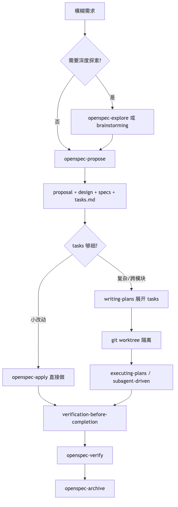
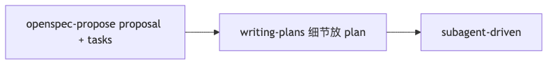
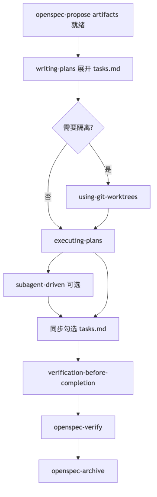
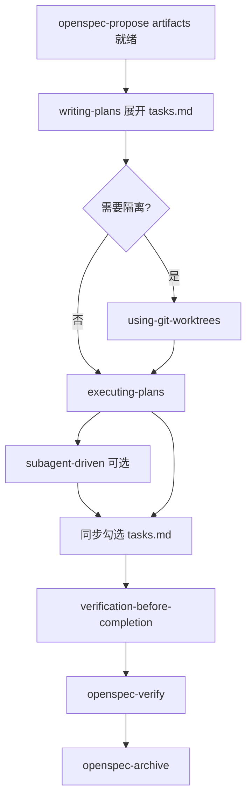
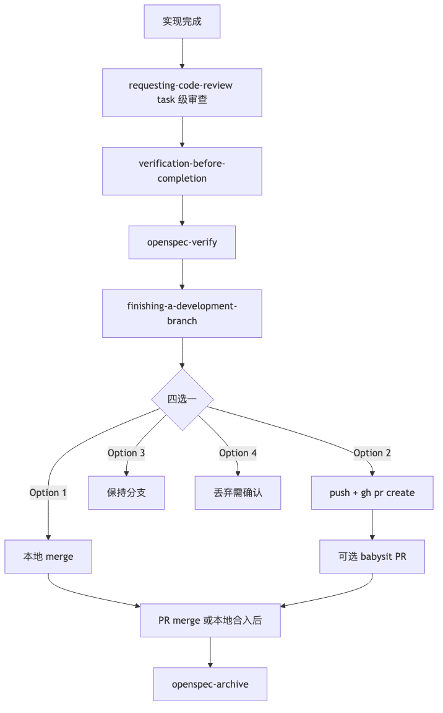
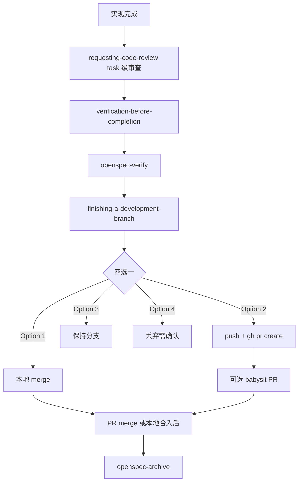

# OpenSpec × Superpowers 混合工作流心得

> 适用项目：SidusDMX（Acrux iPad）  
> 更新日期：2026-05-22（含流程图 PNG + Mermaid 源码 + 准备工作）

---

## 一句话总结

**OpenSpec 负责规范文档和计划任务的生成，Superpowers负责复杂任务的执行和生成单元测试，验证方案。**

两者不是二选一，而是分层互补。

---

## 准备工作

开始混合工作流前，我会先完成以下两项环境配置，便于 Agent 跨仓库读写代码、并通过 Xcode 编译验证。

### 1. 创建多根工作空间（Multi-root Workspace）

SidusDMX 主工程依赖多个独立仓库（主工程、蓝牙 Mesh 库、接口库、同步数据库等）。使用 **VS Code / Cursor 工作空间**（`.code-workspace`）一次打开全部相关项目，Agent 才能在同一会话内检索、修改跨库代码。

**SidusDMX 现有工作空间示例**（`SidusDMX/SidusDMX.code-workspace`）：

| 工作区名称 | 路径 | 说明 |
|------------|------|------|
| Acrux | `../SidusDMX` | 主工程（Acrux iPad App） |
| SLSyncLib | `../SLSyncLib` | 同步数据库库 |
| SLSigMesh | `../SLSigMesh` | 蓝牙 Mesh 库 |
| SLAppServiceKit | `../SLAppServiceKit` | 接口 / 服务层库 |
| cursor | `./.cursor` | Cursor 规则与技能 |

**创建 / 打开方式**：

1. 在 VS Code 或 Cursor 中：**文件 → 将工作区另存为…** → 保存为 `*.code-workspace`
2. 编辑 `folders` 数组，按上表添加各仓库相对路径
3. 日常开发用 **打开工作空间** 而非单独打开单个文件夹

```json
{
    "folders": [
        { "name": "Acrux", "path": "../SidusDMX" },
        { "name": "SLSyncLib", "path": "../SLSyncLib" },
        { "name": "SLSigMesh", "path": "../SLSigMesh" },
        { "name": "SLAppServiceKit", "path": "../SLAppServiceKit" },
        { "name": "cursor", "path": "./.cursor" }
    ],
    "settings": {}
}
```

**注意**：
- 跨库改动时，OpenSpec change 仍放在主工程 `openspec/changes/` 下，plan 中注明涉及的库与文件路径

### 2. 安装 MCP：xcode-tools

在 Cursor **MCP 设置**中启用 **xcode-tools**，让 Agent 通过 MCP 驱动已打开的 Xcode 工程，完成文件读写、编译、测试等操作（需 macOS + 已安装 Xcode）。


配置后于 Cursor **Settings → MCP** 中确认 `xcode-tools` 已启用；

**常用能力**（Agent 可通过 MCP 调用）：

| 类别 | 工具示例 | 用途 |
|------|----------|------|
| 文件操作 | `XcodeRead` / `XcodeWrite` / `XcodeUpdate` / `XcodeMakeDir` / `XcodeMV` / `XcodeRM` | 在 Xcode 工程内读写、创建、移动文件 |
| 工程浏览 | `XcodeLS` / `XcodeGlob` / `XcodeGrep` / `XcodeListWindows` | 列目录、搜索、获取当前 Xcode 窗口 |
| 编译 | `BuildProject` / `GetBuildLog` | 触发编译并读取构建日志 |
| 测试 | `RunAllTests` / `RunSomeTests` / `GetTestList` | 运行单元测试 |
| 问题诊断 | `XcodeListNavigatorIssues` / `XcodeRefreshCodeIssuesInFile` | 读取编译器/静态检查问题 |
| 其他 | `RenderPreview` / `DocumentationSearch` / `ExecuteSnippet` | SwiftUI 预览、文档搜索等 |

**与 Superpowers 验证的配合**：`verification-before-completion` 阶段可指示 Agent「用 xcode-tools 的 `BuildProject` 编译 Acrux」或「`RunAllTests` 跑测试」，以 Xcode 输出作为完成证据。

---

## 核心分工

| 阶段 | 主导工具 | 产出位置 |
|------|----------|----------|
| 需求模糊或者需要结合代码进一步细化 | OpenSpec explore 或 Superpowers brainstorming | 对话 → 填充 OpenSpec artifact（change文件夹里的文档） |
| 生成需求、设计、规范 | proposal + design + delta specs | 同上 |
| 粗粒度任务 | tasks.md | 同上 |
| 细粒度执行计划 | Superpowers writing-plans | `superpowersDocs/plans/YYYY-MM-DD-<name>.md` |
| 写代码 | executing-plans / subagent-driven | 代码 + 勾选 task |
| 验收 | verification-before-completion + OpenSpec verify | 单元测试+验证报告 |
| 收尾 | OpenSpec archive + finishing-a-development-branch | `openspec/specs/` 合并 |

---

## 推荐主流程




## 三种搭配模式

### 模式 A：OpenSpec 为主（推荐默认）


**适合**：功能较单一，逻辑不复杂，没有太多与原有功能的关联。

### 模式 B：Superpowers 探索 + OpenSpec 立项


**适合**：UI/交互复杂、边界条件多、方案需先对齐再立项。

### 模式 C：OpenSpec 轻量 + Superpowers 重执行




**适合**：需求清晰，但需要 TDD / 复杂需求执行。

---

## 探索期：二选一

| 工具 | 特点 | 何时用 |
|------|------|--------|
| **openspec-explore** | 可聊可画图，结论可选写回 change 的 artifact | 已有变更上下文、方案对比 |
| **brainstorming** | 设计阶段工作流，有固定步骤和双重用户批准，产出独立 design spec | 全新功能、需求模糊 |

**原则**：探索结论回填 OpenSpec artifact，不要另起 `superpowersDocs/specs/` 重复写 design（除非纯调研、尚未立项）。

---

## 实现期流程（propose 之后）





**注意**：混用 Superpowers 时走 `writing-plans → executing-plans`，不要与 `openspec-apply` 并行，避免两套进度混乱。

---

## 实现期：OpenSpec 管进度，Superpowers 管步骤

| 场景 | 做法 |
|------|------|
| 小 bug / 单文件 | `openspec-apply` 直接做，勾选 `tasks.md` |
| 中等功能（3–10 个 task） | `writing-plans` 拆成 TDD 小步 → `executing-plans` |
| 大功能 / 多子系统 | `subagent-driven-development`（每 task 一个 subagent + review） |

**Plan 文档头部建议引用 OpenSpec change**，避免两套 task 脱节：

```markdown
# [功能名] Implementation Plan

> OpenSpec change: `<change-name>`
> OpenSpec tasks: `openspec/changes/<change-name>/tasks.md`
> REQUIRED SUB-SKILL: superpowers:executing-plans
```

**执行同步规则**：
- Superpowers plan 的 checkbox → 会话内进度
- 一个 OpenSpec task 全部完成 → `tasks.md` 对应项改为 `- [x]`
- 实现中发现设计问题 → 回写 `design.md` / `tasks.md`，再继续 apply

---


## 文档存放约定

| 内容 | 路径 |
|------|------|
| 变更 proposal / design / specs / tasks | `openspec/changes/<name>/` |
| Superpowers 执行计划 | `superpowersDocs/plans/YYYY-MM-DD-<name>.md` |
| Superpowers 独立设计（无 OpenSpec 时） | `superpowersDocs/specs/YYYY-MM-DD-<topic>-design.md` |
| 归档后主 specs | `openspec/specs/` |

**语言**：OpenSpec artifact 与 Superpowers plan 用中文；代码与文件路径用英文。

---

## 验收与收尾

### Superpowers 收尾链路（含 PR）





### 步骤说明

1. **requesting-code-review** — 实现过程中 task 级审查（subagent-driven 每个 task 后；不是 GitHub PR）
2. **verification-before-completion** — 编译/测试/真机，必须有输出证据
3. **openspec-verify** — 对照 specs + tasks，检查 completeness / correctness / coherence
4. **finishing-a-development-branch** — 四选一：本地 merge / 建 PR / 保持 / 丢弃
5. **babysit PR**（可选）— PR 创建后修 CI、处理 review comments
6. **openspec-archive** — PR merge **之后** 合并 delta specs 到 `openspec/specs/`

---

## 避坑清单

1. **不要双轨维护 design** — 设计决策只写 `design.md`，执行细节写 plan
2. **brainstorming HARD-GATE** — 有 OpenSpec change 且 artifacts 已齐时，先 `writing-plans` 再实现
3. **中途卡住** — 用 `openspec-explore <change>` 或 `systematic-debugging`，结论写回 artifact
4. **小改动可跳过 Superpowers** — 单文件 fix 直接 apply；大功能务必走 plan + 验证
5. **PR 不等于结束** — merge 后还需 `openspec-archive` 合并 specs

---

## 常用技能对照

| 意图 | OpenSpec | Superpowers |
|------|----------|-------------|
| 探索想法 | openspec-explore | brainstorming |
| 新建变更 | openspec-new-change / openspec-propose | — |
| 继续写 artifact | openspec-continue-change | — |
| 写执行计划 | — | writing-plans |
| 实现 | openspec-apply-change | executing-plans / subagent-driven |
| 代码审查 | — | requesting-code-review |
| 验收 | openspec-verify-change | verification-before-completion |
| 归档 | openspec-archive-change | finishing-a-development-branch |
| 隔离开发 | — | using-git-worktrees |
| PR 跟进 | — | babysit |

